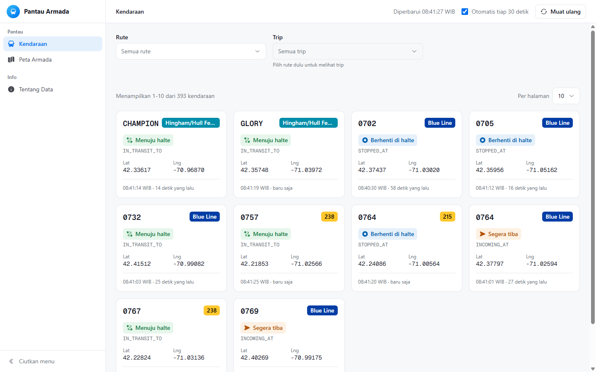
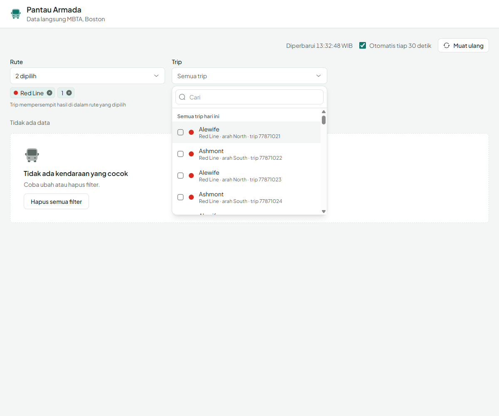
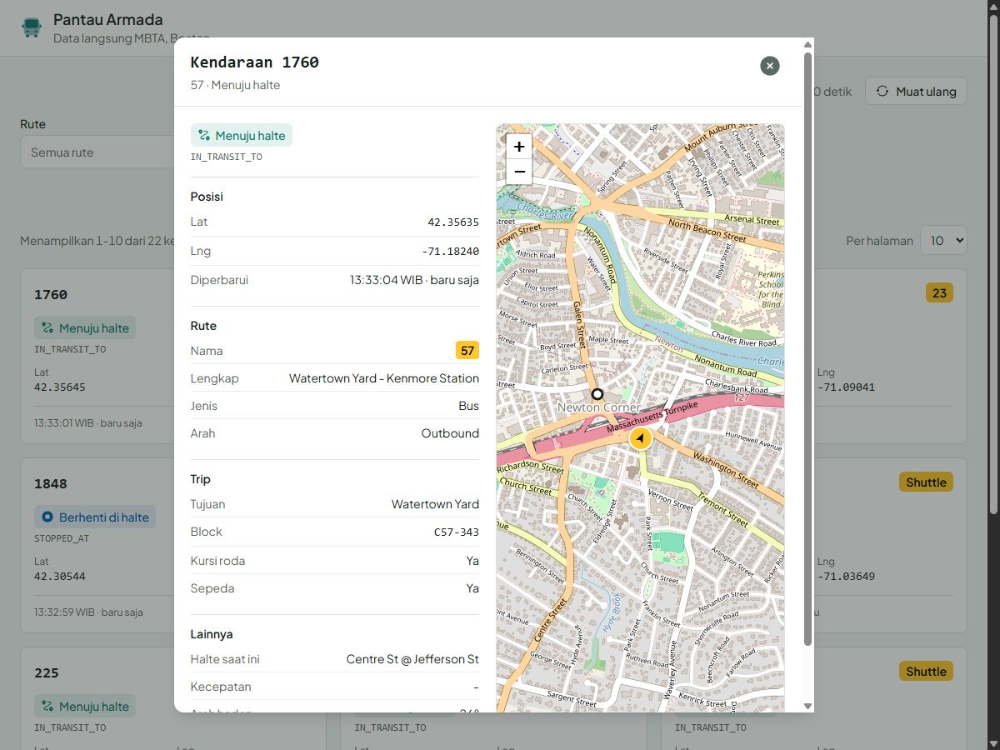
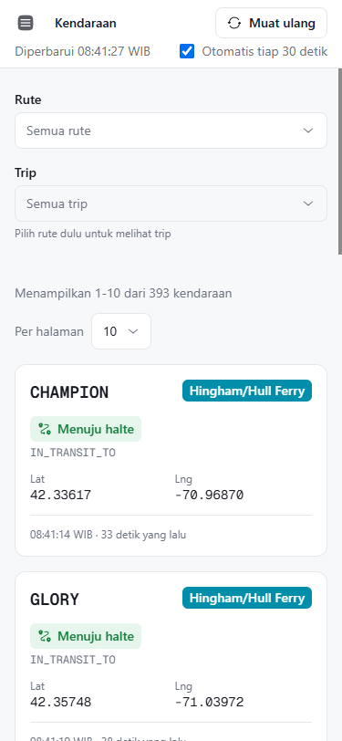

# Pantau Armada

Aplikasi satu halaman untuk memantau kendaraan MBTA (Boston) secara langsung: grid kartu kendaraan, filter rute dan trip, pagination lengkap, dan popup detail dengan peta. Dibuat untuk tes teknis Frontend Engineer (Sistem Manajemen Armada). Nama dan tampilannya sengaja netral, data diambil dari MBTA V3 API.

- Demo: https://tistow.github.io/fleet-management-frontend/
- Video penjelasan: lihat email pengiriman



## Menjalankan

Butuh Node 22.

```bash
npm ci
npm run dev        # pengembangan lokal
npm run build      # build produksi ke dist/
npm run preview    # menjalankan hasil build
npm test           # vitest (69 tes)
npm run lint       # oxlint
npm run typecheck  # tsc -b --noEmit
```

## Konfigurasi

MBTA membatasi 20 permintaan per menit per IP tanpa API key. Untuk batas yang lebih longgar (1000 per menit), daftar key gratis di https://api-v3.mbta.com, lalu buat `.env.local`:

```
VITE_MBTA_API_KEY=isi_key_anda
```

Variabel ini opsional. Key di aplikasi frontend ikut masuk ke bundle dan terlihat publik, jadi perlakukan sebagai konfigurasi, bukan rahasia.

## Arsitektur

```
src/
  api/          client.ts (fetch bertipe), errors.ts, jsonapi.ts, vehicles.ts, routes.ts, trips.ts
  hooks/        useUrlState, useVehicles, useRouteOptions, useTripOptions,
                useVehicleDetail, useRateLimitRetry
  components/   MultiSelect, Pagination, PageSizeSelect, StatusBadge, ErrorState,
                StaleBanner, EmptyState, Skeletons, Spinner
  features/vehicles/
                VehiclesPage, VehicleFilters, VehicleGrid, VehicleCard,
                VehicleDetailModal, VehicleMap
  lib/          paginate, status, format, tripSelection
  types/        mbta.ts
```

`api/` mengenal MBTA, `hooks/` mengenal TanStack Query, `components/` generik tanpa pengetahuan MBTA, dan `features/vehicles/` merangkai semuanya.

```
query string (route, trip, page, size, vehicle)
        |
  VehiclesPage -- useVehicles ---------+
        |         useRouteOptions       |-- TanStack Query cache -- api/client.ts (fetch) -- MBTA V3
        |         useTripOptions        |                           api/jsonapi.ts (parse)
        |         useVehicleDetail -----+
        +-- VehicleFilters (MultiSelect x2)
        +-- VehicleGrid -> VehicleCard -> StatusBadge
        +-- Pagination + PageSizeSelect   (paginate() di client)
        +-- VehicleDetailModal -> VehicleMap (lazy: Leaflet + OpenStreetMap)
```

### Pengambilan data

Semua data diambil dengan `fetch` bawaan browser lewat satu fungsi bertipe, `apiGet`, yang menyusun parameter JSON:API (`filter[route]`, `page[limit]`), menambahkan API key bila ada, meneruskan `AbortSignal`, dan mengubah respons `errors[]` menjadi `ApiError`. Di atasnya TanStack Query: `useQuery` untuk daftar dan detail kendaraan, `useInfiniteQuery` untuk dropdown rute dan trip (halaman berikutnya dari `links.next`). Hasilnya di-cache per filter, jadi pindah halaman dan membuka ulang dropdown tidak memanggil API lagi. Respons mentah dipetakan sekali di `api/` ke objek datar, sehingga komponen tidak menyentuh `attributes` atau `relationships`.

### Tampilan

React 19 dengan function component dan hooks, TypeScript strict, Tailwind CSS v4 dengan token warna sendiri di `src/index.css`, ikon Solar dari Iconify yang dibundel (tanpa permintaan ke api.iconify.design), font Plus Jakarta Sans self-host lewat Fontsource, dan peta Leaflet (react-leaflet) dengan tile OpenStreetMap. Tidak memakai UI kit. Dropdown multi-select ditulis sendiri mengikuti pola ARIA combobox dan listbox, dan popup memakai elemen native `<dialog>` supaya ESC, fokus, dan penguncian latar ditangani browser.

### Pagination

API MBTA tidak mengirim total data, hanya link `first`, `next`, dan `last`. Karena seluruh armada hanya sekitar 17 KB (gzip), saya ambil semua kendaraan sesuai filter dalam satu request, lalu fungsi murni `paginate()` di `src/lib/paginate.ts` menghitung rentang ("Menampilkan 11-20 dari 330 kendaraan"), jumlah halaman, dan potongan datanya. Dengan cara ini total selalu pasti, urutan stabil (`sort=label`), pindah halaman tidak memakai kuota 20 permintaan per menit, dan data yang bergeser antar request tidak membuat kendaraan dobel atau terlewat. Pilihan per halaman: 5, 10, 20, 50. Saat ukuran diganti, item pertama yang sedang dilihat tetap tampil.

### Filter

- **Rute**: `useInfiniteQuery` ke `/routes`, 30 per request, dimuat bertahap saat daftar di-scroll (sentinel `IntersectionObserver`). Pencarian di dropdown memfilter item yang sudah dimuat dan terus memuat halaman berikutnya sampai ada yang cocok.
- **Trip**: bergantung pada rute yang dipilih, karena `/trips` menolak permintaan tanpa filter (400). Dropdown nonaktif dengan petunjuk sampai ada rute. Satu rute bisa punya sekitar 2.000 trip per hari, jadi trip yang sedang dilalui kendaraan ditampilkan lebih dulu di grup "Sedang berjalan". Melepas rute ikut melepas trip miliknya, dan trip dari URL dipulihkan lewat `filter[id]`.
- Rute dan trip dikirim ke API sebagai `filter[route]` dan `filter[trip]` (logika AND).



### State di URL

Filter, halaman, ukuran, dan kendaraan yang dibuka disimpan di query string (`?route=Red,1&trip=...&page=2&size=20&vehicle=y1841`), lewat hook `useUrlState` tanpa router. Tautan bisa dibagikan, tombol Back menutup popup detail dan kembali ke daftar, dan refresh di GitHub Pages aman karena tidak ada path selain `/`. Mengganti filter mengembalikan halaman ke 1.

### Error dan batas permintaan

`api/errors.ts` memetakan error ke pesan Indonesia: jaringan putus, 429, 400, 404, 5xx. Kebijakan retry: jaringan dan 5xx diulang dua kali, 429 sekali, 4xx lain tidak. Header `x-ratelimit-*` tidak bisa dibaca browser (CORS tidak mengeksposnya), jadi saat 429 hitung mundur dihitung sendiri sampai batas menit berikutnya dan permintaan diulang otomatis di sana. Bila pembaruan gagal tetapi data lama masih ada, grid tetap tampil dengan banner "Gagal memperbarui, menampilkan data terakhir". Data diperbarui otomatis tiap 30 detik (bisa dimatikan, berhenti saat tab tersembunyi), plus tombol "Muat ulang".

### Peta

`VehicleMap` dimuat dengan `React.lazy` hanya saat popup dibuka, jadi Leaflet (sekitar 155 KB) tidak ikut bundle awal. Penanda memakai `DivIcon` berwarna sesuai rute dan berputar mengikuti arah hadap, sehingga masalah ikon PNG bawaan Leaflet di bundler tidak muncul. Peta bergeser mengikuti posisi saat data diperbarui (detail ikut dimuat ulang tiap 30 detik selama popup terbuka), ukurannya dihitung ulang saat popup selesai tampil, kegagalan memuat tile ditampilkan sebagai pemberitahuan kecil, dan bila chunk peta gagal dimuat popup tetap bisa dipakai dengan tombol "Coba lagi".



## Checklist fitur

| Kebutuhan tes | Implementasi |
|---|---|
| Daftar kendaraan dari API | `api/vehicles.ts`, `hooks/useVehicles.ts`, `features/vehicles/VehicleGrid.tsx` |
| Label, status (IN_TRANSIT_TO, STOPPED_AT, dll), lat/lng, waktu update | `VehicleCard.tsx`, `components/StatusBadge.tsx`, `lib/status.ts`, `lib/format.ts` |
| Filter Route, multi-select, infinite scroll dari API | `VehicleFilters.tsx`, `hooks/useRouteOptions.ts`, `components/MultiSelect.tsx` |
| Filter Trip mengikuti route | `hooks/useTripOptions.ts`, `lib/tripSelection.ts`, `api/trips.ts` |
| Pagination: rentang, jumlah halaman, pilihan per halaman, pindah halaman | `lib/paginate.ts`, `components/Pagination.tsx`, `components/PageSizeSelect.tsx` |
| Popup detail kendaraan dengan peta | `VehicleDetailModal.tsx`, `VehicleMap.tsx`, `hooks/useVehicleDetail.ts` |
| Loading, kosong, dan error | `components/Skeletons.tsx`, `EmptyState.tsx`, `ErrorState.tsx`, `StaleBanner.tsx` |
| Responsif | grid 1 sampai 4 kolom, popup layar penuh di HP |
| TypeScript dan tes | `strict`, 69 tes (vitest + Testing Library), lint dan typecheck di CI |
| Deploy | GitHub Pages lewat `.github/workflows/deploy.yml` |



## Batasan API MBTA yang membentuk desain

- Tidak ada total data. Respons hanya memuat `links`, dan hasil kosong tidak punya `links` sama sekali.
- `/trips` wajib punya filter, tanpa filter hasilnya 400 "At least one filter[] is required."
- Tanpa API key: 20 permintaan per menit, jendelanya per menit kalender, dan tidak ada `Retry-After`.
- Header rate limit tidak terbaca dari JavaScript karena tidak ada `access-control-expose-headers`.
- Tidak ada pencarian teks untuk rute dan trip, jadi pencarian di dropdown hanya atas item yang sudah dimuat.
- Isi `included` tidak berurutan, jadi diindeks per `type:id`.

## Keterbatasan

- Pagination di client cocok untuk armada ribuan kendaraan. Bila lebih dari sekitar 5.000, ganti ke `page[offset]` dengan total dari `links.last`.
- Pencarian di dropdown hanya mencakup item yang sudah dimuat (untuk trip, pemuatan otomatis dibatasi lima halaman per kata kunci).
- Tidak ada dark mode.
- API key di frontend bersifat publik.
- Data kosong saat MBTA tidak beroperasi (sekitar 01:00-05:00 waktu Boston).
- Tes komponen memakai jsdom, jadi fokus kembali ke kartu dan penguncian fokus popup tidak diuji otomatis.
